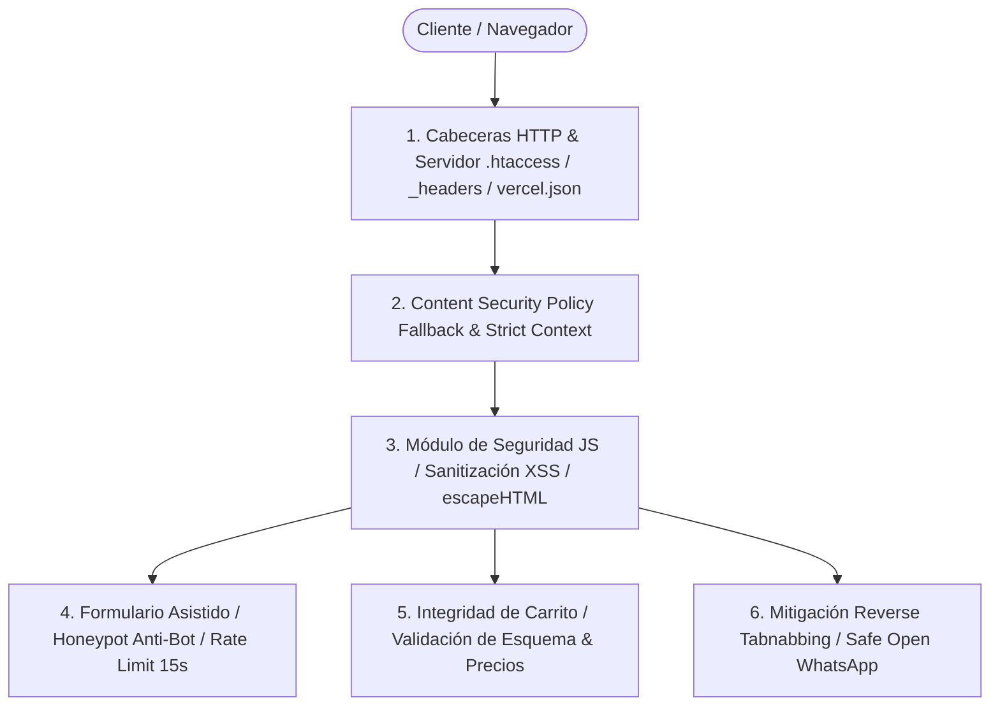

# 🛡️ Política y Arquitectura Integral de Seguridad (Multi-Capa)

Este documento describe la arquitectura de seguridad implementada en el sitio web de **TecnoFix Colombia** conforme a las mejores prácticas de OWASP Top 10 (Client-Side), normativas de privacidad (Ley 1581 de 2012 de Colombia) y endurecimiento de servidores web para aplicaciones estáticas nativas (HTML5, CSS3, JavaScript Vanilla ES6+).

---

## 📑 Índice de Contenidos

1. [Arquitectura de Seguridad en 6 Capas](#1-arquitectura-de-seguridad-en-6-capas)
2. [Capa 1: Endurecimiento de Cabeceras HTTP y Servidor Web](#capa-1-endurecimiento-de-cabeceras-http-y-servidor-web)
3. [Capa 2: Content Security Policy (CSP) en Servidor y Cliente](#capa-2-content-security-policy-csp-en-servidor-y-cliente)
4. [Capa 3: Prevención de XSS y Manipulación del DOM](#capa-3-prevención-de-xss-y-manipulación-del-dom)
5. [Capa 4: Seguridad en Formularios, Anti-Spam y Rate Limiting](#capa-4-seguridad-en-formularios-anti-spam-y-rate-limiting)
6. [Capa 5: Integridad de Almacenamiento Local (localStorage) y Estado](#capa-5-integridad-de-almacenamiento-local-localstorage-y-estado)
7. [Capa 6: Reverse Tabnabbing y Validación de Redirecciones Externas](#capa-6-reverse-tabnabbing-y-validación-de-redirecciones-externas)
8. [Privacidad y Cumplimiento Normativo (Ley 1581 de 2012)](#privacidad-y-cumplimiento-normativo-ley-1581-de-2012)
9. [Guía de Pruebas y Validación](#guía-de-pruebas-y-validación)

---

## 1. Arquitectura de Seguridad en 6 Capas



---

## Capa 1: Endurecimiento de Cabeceras HTTP y Servidor Web

Para proteger la entrega de activos estáticos y mitigar vectores como el clickjacking, MIME-sniffing e intercepción de tráfico, se implementaron configuraciones multiplataforma:

### Archivos de Configuración Desplegados:
1. [`.htaccess`](file:///c:/Users/JHON/Desktop/MINEGOCIO/.htaccess) — Para servidores Apache, LiteSpeed y cPanel hosting.
2. [`_headers`](file:///c:/Users/JHON/Desktop/MINEGOCIO/_headers) — Para plataformas como Cloudflare Pages y Netlify.
3. [`vercel.json`](file:///c:/Users/JHON/Desktop/MINEGOCIO/vercel.json) — Para despliegues en infraestructura Vercel Edge.

### Cabeceras HTTP Configurales:
| Cabecera | Valor | Propósito de Seguridad |
|---|---|---|
| `Strict-Transport-Security` (HSTS) | `max-age=31536000; includeSubDomains; preload` | Fuerza comunicación HTTPS estricta por 1 año e impide ataques SSL-Strip. |
| `X-Frame-Options` | `SAMEORIGIN` | Bloquea la incrustación del sitio en iframes externos, neutralizando ataques de Clickjacking. |
| `X-Content-Type-Options` | `nosniff` | Impide que el navegador intente adivinar el tipo MIME de archivos ejecutables o SVG. |
| `X-XSS-Protection` | `1; mode=block` | Activa el filtro heurístico anti-XSS en navegadores legados. |
| `Referrer-Policy` | `strict-origin-when-cross-origin` | Evita la fuga de URLs y parámetros internos hacia sitios externos. |
| `Permissions-Policy` | `camera=(), microphone=(), geolocation=(), payment=(), usb=()` | Deshabilita hardware del dispositivo innecesario, reduciendo la superficie de ataque. |

### Reglas de Bloqueo en Servidor (.htaccess):
- **Bloqueo de directorios ocultos:** Deniega el acceso a `.git`, `.env`, `.agents`, etc.
- **Bloqueo de inyecciones de script en URL:** Filtra firmas de `<script>`, `[<>]`, `eval()`, `mosconfig`, `document.cookie` en la Query String.
- **Protección de listado de directorios:** `Options -Indexes` previene la visualización del listado de archivos en directorios sin index.

---

## Capa 2: Content Security Policy (CSP) en Servidor y Cliente

Se definió una política rigurosa tanto a nivel de cabecera de servidor como en metaetiqueta HTML fallback (`<meta http-equiv="Content-Security-Policy">`) en todas las páginas del proyecto ([`index.html`](file:///c:/Users/JHON/Desktop/MINEGOCIO/index.html), [`servicios.html`](file:///c:/Users/JHON/Desktop/MINEGOCIO/servicios.html), [`productos.html`](file:///c:/Users/JHON/Desktop/MINEGOCIO/productos.html), [`nosotros.html`](file:///c:/Users/JHON/Desktop/MINEGOCIO/nosotros.html), [`preguntas-frecuentes.html`](file:///c:/Users/JHON/Desktop/MINEGOCIO/preguntas-frecuentes.html), [`contacto.html`](file:///c:/Users/JHON/Desktop/MINEGOCIO/contacto.html)):

```http
Content-Security-Policy: default-src 'self';
  script-src 'self' 'unsafe-inline' https://cdn.jsdelivr.net;
  style-src 'self' 'unsafe-inline' https://fonts.googleapis.com;
  font-src 'self' https://fonts.gstatic.com;
  img-src 'self' data: https:;
  connect-src 'self';
  form-action 'self' https://wa.me;
  frame-ancestors 'self';
```

- **Restricción de Conexiones (`connect-src 'self'`):** Impide que scripts maliciosos envíen peticiones exfiltradoras de datos hacia servidores C2 (Command & Control).
- **Destino de Formularios (`form-action 'self' https://wa.me`):** Bloquea el envío de formularios a destinos arbitrarios.
- **Protección de Enmarcado (`frame-ancestors 'self'`):** Refuerzo CSP complementario a `X-Frame-Options`.

---

## Capa 3: Prevención de XSS y Manipulación del DOM

El módulo centralizado [`assets/js/security.js`](file:///c:/Users/JHON/Desktop/MINEGOCIO/assets/js/security.js) provee utilidades inmutables (`Object.freeze`) para neutralizar cualquier vector de Cross-Site Scripting (XSS):

### 1. Escape de Entidades HTML (`Security.escapeHTML`):
Convierte caracteres peligrosos (`&`, `<`, `>`, `"`, `'`, `/`) en sus correspondientes entidades HTML seguras (`&amp;`, `&lt;`, `&gt;`, `&quot;`, `&#x27;`, `&#x2F;`), neutralizando inyecciones en `innerHTML`.

### 2. Sanitización de Textos (`Security.sanitizeText`):
- Elimina etiquetas HTML y constructos de script.
- Limpia caracteres de control ASCII (0-31 excepto saltos de línea estándar).
- Limita la longitud máxima de caracteres permitida para evitar desbordamientos de memoria o congelamiento del DOM.

### 3. Validación Estricta de URLs (`Security.sanitizeUrl`):
- Bloquea pseudo-protocolos ejecutables como `javascript:`, `data:` o `vbscript:`.
- Admite únicamente URLs relativas (`/`, `assets/...`) o protocolos seguros `https://` y `http://`.

---

## Capa 4: Seguridad en Formularios, Anti-Spam y Rate Limiting

En la página de contacto ([`contacto.html`](file:///c:/Users/JHON/Desktop/MINEGOCIO/contacto.html)) y su controlador ([`assets/js/formulario.js`](file:///c:/Users/JHON/Desktop/MINEGOCIO/assets/js/formulario.js)):

### 1. Trampa Anti-Bot Invisible (Honeypot):
Se incluyó un campo oculto fuera de la pantalla mediante posicionamiento CSS absoluto y atributos de accesibilidad:
```html
<div style="opacity:0;position:absolute;top:0;left:0;height:0;width:0;z-index:-1;overflow:hidden;" aria-hidden="true">
  <label for="contacto-hp-field">Si eres humano, deja este campo vacío</label>
  <input type="text" id="contacto-hp-field" name="_hp_security_check" tabindex="-1" autocomplete="off">
</div>
```
- **Comportamiento:** Si un robot automatizado rellena el campo, el envío se descarta en silencio (`silent fail`), frustrando el análisis del atacante.

### 2. Control de Frecuencia / Rate Limiting en Cliente:
- Cooldown mandatorio de **15 segundos** entre solicitudes consecutivas (`Security.checkRateLimit('contacto_formulario', 15)`).
- Evita spam accidental o abusivo del botón de cotización.

### 3. Acotación Estricta de Campos (`maxlength`):
- Nombre completo: 80 caracteres.
- Teléfono / Móvil: 20 caracteres (solo números y espaciado).
- Correo electrónico: 100 caracteres.
- Descripción técnica: 1000 caracteres.

---

## Capa 5: Integridad de Almacenamiento Local (localStorage) y Estado

El módulo del carrito de compras ([`assets/js/carrito.js`](file:///c:/Users/JHON/Desktop/MINEGOCIO/assets/js/carrito.js)) implementa validación criptográfica y de integridad contra manipulación deliberada en DevTools:

1. **Prevención de Manipulación de Precios:** Los precios no se confían a ciegas del almacenamiento local; al invocar `obtenerCarrito()`, los productos son cotejados con el catálogo inmutable [`assets/js/productos-data.js`](file:///c:/Users/JHON/Desktop/MINEGOCIO/assets/js/productos-data.js), sobreescribiendo cualquier alteración de valor.
2. **Límites de Cantidad:** Cada producto tiene un tope máximo de 99 unidades por pedido para evitar inconsistencias numéricas.
3. **Neutralización de DOM-XSS en el Carrito:** Antes de inyectar las filas en el drawer del carrito, los nombres de productos son procesados por `Security.escapeHTML()`.

---

## Capa 6: Reverse Tabnabbing y Validación de Redirecciones Externas

Todos los hipervínculos con `target="_blank"` hacia plataformas externas (WhatsApp, etc.):
1. Cuentan con el atributo `rel="noopener noreferrer"`.
2. Las funciones de apertura vía JavaScript utilizan `Security.safeOpen(url)`:
   - Valida que el enlace comience con `https://wa.me/` o `https://api.whatsapp.com/`.
   - Limpia la propiedad `opener` de la nueva ventana para impedir que páginas externas redirijan al usuario a sitios fraudulentos o de phishing.

---

## Privacidad y Cumplimiento Normativo (Ley 1581 de 2012)

1. **Tratamiento de Datos Personales:** El formulario de contacto incluye una casilla de consentimiento explícito e ineludible bajo la Ley Estatutaria 1581 de 2012 y el Decreto 1377 de 2013 de la República de Colombia.
2. **Arquitectura sin Backend (Cero Fuga de Datos):** Este sitio web opera como un catálogo y enrutador asistido hacia WhatsApp. No almacena nombres, correos ni datos de pago en bases de datos vulnerables o servidores intermedios de terceros.

---

## Guía de Pruebas y Validación

Para verificar la integridad del sistema de seguridad de forma automatizada mediante PowerShell:

```powershell
# Comprobar inclusión de security.js en todos los archivos HTML
Get-ChildItem -Filter *.html | ForEach-Object {
    $content = Get-Content $_.FullName -Raw
    $hasSecScript = $content -match "assets/js/security.js"
    $hasCSPMeta = $content -match "Content-Security-Policy"
    Write-Host "$($_.Name): Script=$hasSecScript, CSP=$hasCSPMeta"
}
```

---
*Documento de Seguridad — TecnoFix Colombia — 2026*
